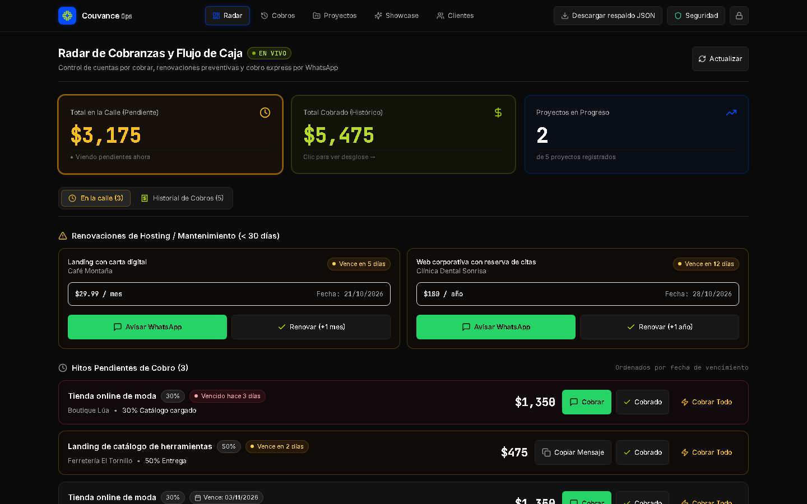
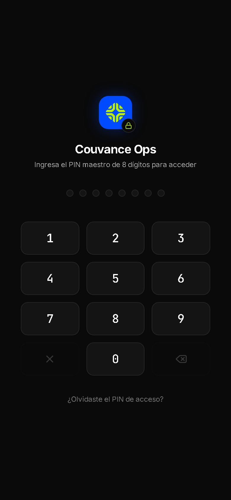
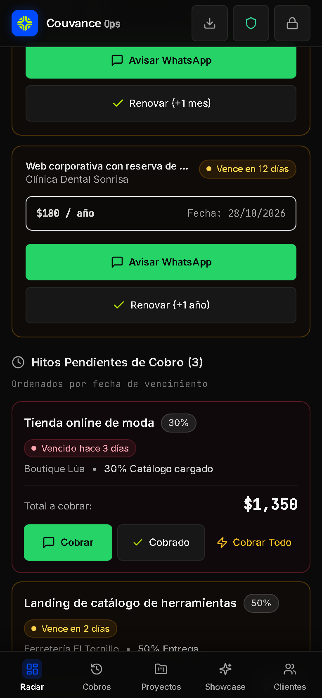
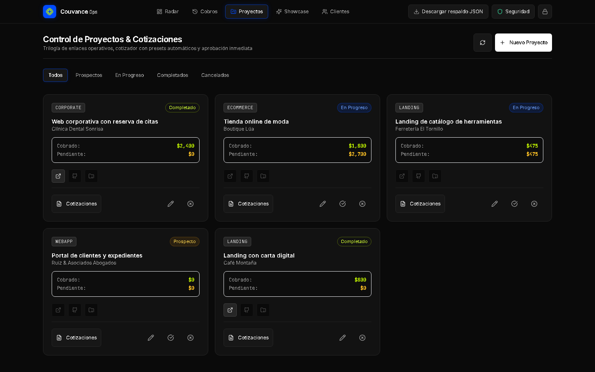
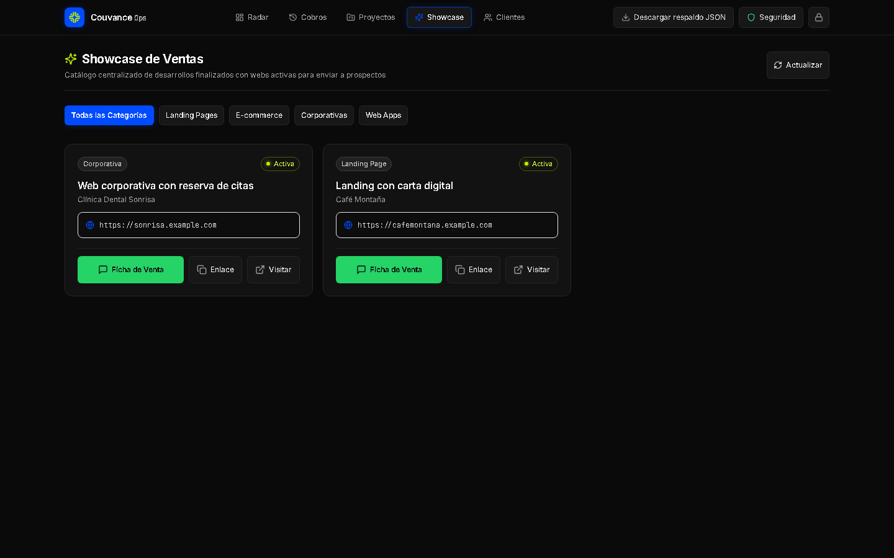
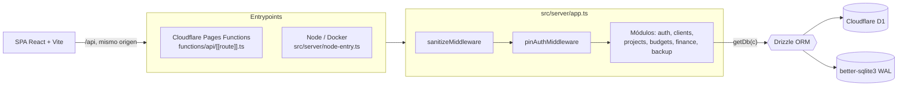

# Couvance Ops

**Cobra a tiempo sin abrir un ERP.** Radar de pagos pendientes, aviso por WhatsApp en un toque y presupuestos que siempre cuadran al centavo.

[](tsconfig.json)
[](src/server/app.ts)
[](src/client/src/App.tsx)
[](wrangler.toml)
[](test/)

Couvance Ops está en producción: la usamos a diario los dos socios de Couvance, una agencia digital, para saber quién nos debe, avisarle y registrar el cobro desde el móvil. Corre gratis en Cloudflare Pages + D1, y el mismo código funciona en Docker con SQLite.

> **¿Por qué no hay demo pública?** La instancia en producción guarda datos reales de clientes. Las capturas usan datos ficticios y puedes levantar la app en local en un par de minutos ([Puesta en marcha](#puesta-en-marcha)).

<p align="center">
  
</p>

<p align="center">
  
  &nbsp;&nbsp;
  
</p>

---

## El problema

En una agencia pequeña el dinero no se pierde por falta de clientes, se pierde por cobros que se postergan:

- **Hitos entregados que nadie cobra.** El trabajo está publicado, pero mandar el recordatorio exige buscar el monto, el proyecto y el teléfono del cliente.
- **Renovaciones que vencen en silencio.** Hosting y mantenimiento que expiran sin facturarse y que termina pagando la agencia.
- **Cobrar desde la calle es incómodo.** Entre reuniones nadie redacta un mensaje de cobro, así que queda para "luego".

## Qué hace

- **Radar de cobranzas.** Una pantalla con lo pendiente ordenado por vencimiento (vencido, vence en ≤ 2 días, futuro) y los servicios recurrentes que renuevan en los próximos 30 días.
- **Cobro por WhatsApp en un toque.** Abre `wa.me` con el monto, el proyecto y un mensaje cordial listo. Si el cliente no tiene teléfono, copia el mensaje al portapapeles y avisa con un toast.
- **Presupuestos que cuadran.** Esquemas 50/50 o 40/30/30 con montos enteros; el último hito absorbe el redondeo para que la suma sea exactamente el total.
- **Aprobar y cobrar sin pasos extra.** Aprobar un presupuesto activa el proyecto y deja sus hitos listos para cobrar en una sola operación atómica. *Cobrar Todo* liquida los pendientes de un presupuesto de una vez.
- **Showcase para vender.** Catálogo de proyectos terminados y online, con una ficha lista para enviar por WhatsApp a un prospecto.

<p align="center">
  
  
</p>

---

## Decisiones técnicas

| Decisión | Alternativa descartada | Por qué |
| :--- | :--- | :--- |
| **Una app Hono, dos runtimes** (Cloudflare Pages + D1 / Node + SQLite) | Atarse a un solo proveedor | Producción cuesta $0 en el plan gratuito de Cloudflare, y la misma app corre en Docker si algún día hay que salir de ahí. |
| **Web Crypto (SHA-256 + HMAC)** | `bcrypt` / `argon2` | Los módulos nativos en C++ no corren en los isolates de Cloudflare. Web Crypto funciona igual en Edge y en Node. |
| **PIN de 8 dígitos + cookie de 30 días** | OAuth / Auth0 / Supabase | Son dos usuarios que comparten la operación. Un PIN recordado por dispositivo cubre la necesidad sin servicios externos ni costes por usuario. |
| **Montos enteros con absorción del residuo** | Decimales en coma flotante | Evita los "centavos fantasma" (`0.1 + 0.2`). La suma de hitos es igual al total por construcción, y está testeado. |
| **Transiciones CSS nativas** | Framer Motion | Menos JavaScript en móviles de gama baja, que es donde se usa el radar. |

### Cómo está armado



- **Base de datos agnóstica.** Los handlers piden la conexión con `getDb(c)` ([`src/server/db/index.ts`](src/server/db/index.ts)), que devuelve D1 en Cloudflare o SQLite en Node. Las operaciones de varias tablas usan `db.batch` en D1 y `db.transaction` en SQLite.
- **Arranque autónomo en Node.** Al iniciar aplica las migraciones de `./drizzle`, crea las credenciales iniciales si la base está vacía y sirve la SPA compilada.

### Reglas de negocio

Las reglas que protegen el dinero están documentadas como invariantes (RN-01 a RN-10 en [`agents.md`](agents.md)) y cubiertas por tests:

- Montos de presupuestos e hitos **enteros**; el último hito absorbe el residuo ([`calculateMilestonesAmounts`](src/server/modules/budgets/index.ts), [`test/budgets.test.ts`](test/budgets.test.ts)).
- Los porcentajes de los hitos suman **exactamente 100**, si no la API responde `400`.
- Cancelar un proyecto anula los hitos pendientes pero **nunca toca los ya cobrados**.
- No se puede borrar un cliente con proyectos: la API responde `409 Conflict`.
- El respaldo JSON exporta clientes, proyectos, presupuestos e hitos, **nunca** credenciales ni hashes.

### Seguridad

- PIN y respuestas secretas guardados como SHA-256 con un secreto de servidor (`PIN_SECRET`), comparados en tiempo constante.
- Sesión firmada con HMAC-SHA256 en una cookie `HttpOnly`, `SameSite=Lax` (necesario para volver desde WhatsApp sin perder la sesión) y 30 días de validez.
- Límite de 5 intentos fallidos cada 15 minutos por IP en `/api/auth/*`.
- Rechazo de bytes nulos en URL y query params, limpieza de textos en los esquemas Zod (`sanitizedText`) e IDs de ruta validados contra `^[a-zA-Z0-9_-]{1,64}$`.
- Sin CORS: la SPA y la API comparten origen, así que ningún sitio externo puede hacer peticiones autenticadas ([`test/cors.test.ts`](test/cors.test.ts)).

---

## Tests

- **Vitest:** integración de la API contra SQLite en memoria (ciclo completo de clientes, proyectos, presupuestos y cobros), reglas contables, CORS y componentes de UI con Testing Library.
- **Playwright:** flujos de punta a punta (desbloqueo, alta de clientes, WhatsApp y portapapeles, edición de proyectos) contra el servidor real.

```bash
npm test                                              # Vitest
npx vitest run test/budgets.test.ts -t "texto"        # un archivo o un caso
npm run test:e2e                                      # Playwright (levanta el servidor solo)
npx tsc --noEmit                                      # verificación de tipos
```

---

## Puesta en marcha

Requisitos: Node.js 20+ y npm 10+. Docker es opcional.

### Local

```bash
git clone https://github.com/alfonsojms/couvance-ops.git
cd couvance-ops
npm install
cp .env.example .env

npm run dev:server   # API en http://localhost:3000 (SQLite en ./data)
npm run dev          # SPA en http://localhost:5173 (proxy de /api al puerto 3000)
```

En Windows, `INICIAR.bat` levanta ambos a la vez.

Credenciales iniciales: PIN `12345678`. Respuestas secretas: `couvance` y `valencia`. Puedes cambiarlas con las variables de `.env.example` o desde la pantalla de Seguridad.

### Docker

```bash
docker compose up -d --build
```

Compila cliente y servidor, aplica migraciones al arrancar y queda en `http://localhost:3000`, con los datos en el volumen `couvance_data`.

### Cloudflare Pages + D1

```bash
npx wrangler d1 create couvance-ops-db        # copia el database_id a wrangler.toml
npm run db:migrate:prod
npx wrangler pages secret put PIN_SECRET
npm run build:client
npx wrangler pages deploy dist/client
```

Si la base está vacía, la primera petición crea las credenciales iniciales. Cámbialas antes de usar la app con datos reales.

---

## Limitaciones y próximos pasos

- **Un solo PIN compartido.** Está pensado para dos socios; no hay usuarios ni roles separados.
- **Rate limit en memoria.** En Node es estricto; en Cloudflare cada isolate lleva su propio contador, así que ahí solo mitiga.
- **Los E2E comparten la base local.** Corridas repetidas acumulan datos y algunos tests fallan por elementos duplicados. El siguiente paso es darles una base aislada por corrida.
- **Capas por separar.** Hoy los handlers mezclan HTTP, validación y acceso a datos. La lógica de cálculo ya está aislada en funciones puras; falta separar dominio y repositorios por módulo.
- **Integración continua pendiente.** Los tests se corren en local antes de cada despliegue.

---

## Autor

Desarrollado por **Alfonso Mendoza**, fullstack developer (TypeScript, React, Node, Cloudflare).

- GitHub: [@alfonsojms](https://github.com/alfonsojms)
- Email: [alfonsojmendozas@gmail.com](mailto:alfonsojmendozas@gmail.com)
