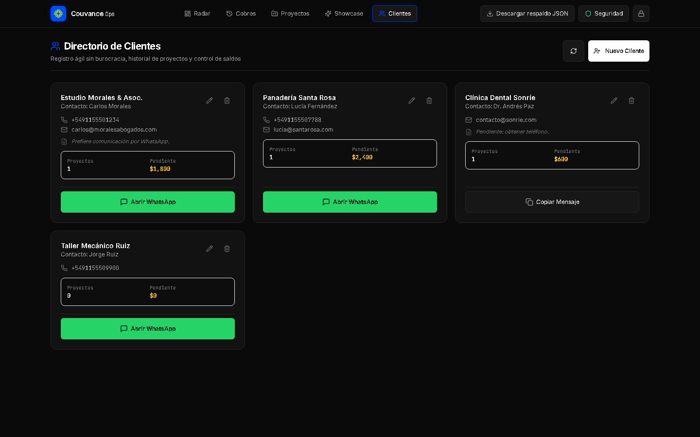
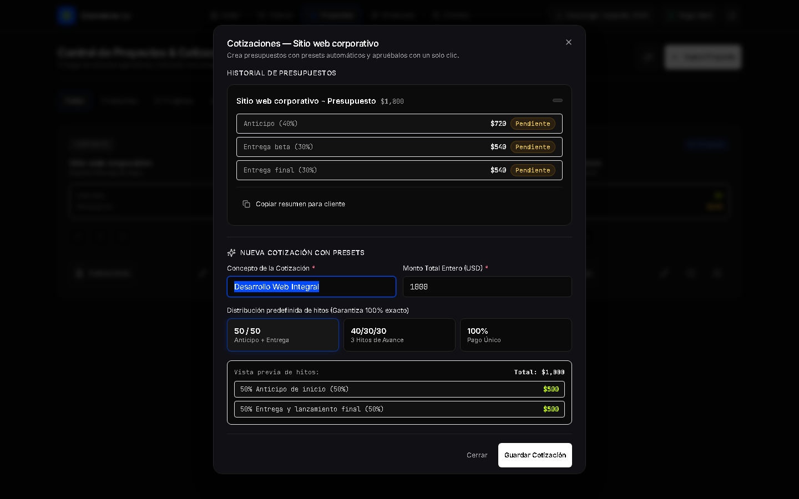
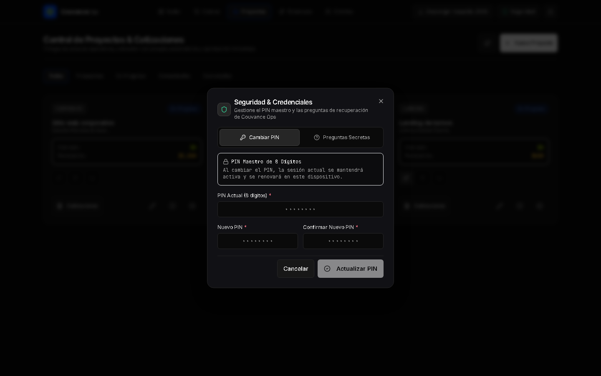
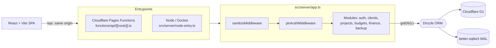

# Couvance Ops

**Get paid on time without opening an ERP.** A radar of pending payments, a one-tap WhatsApp reminder, and budgets that always add up to the cent.

[](tsconfig.json)
[](src/server/app.ts)
[](src/client/src/App.tsx)
[](wrangler.toml)
[](test/)

Couvance Ops is in production: the two partners of Couvance, a digital agency, use it every day to see who owes us money, nudge them, and record the payment from a phone. It runs for free on Cloudflare Pages + D1, and the same code runs on Docker with SQLite.

> **Why is there no public demo?** The production instance holds real client data. All screenshots use fictional data, and you can run the app locally in a couple of minutes ([Getting started](#getting-started)).

<p align="center">
  
</p>

<p align="center">
  
  &nbsp;&nbsp;
  
</p>

---

## The problem

In a small agency, money is rarely lost for lack of clients. It is lost to payments that keep getting postponed:

- **Delivered milestones nobody charges for.** The work is live, but sending a reminder means digging up the amount, the project and the client's phone number.
- **Renewals that expire silently.** Hosting and maintenance lapse without being invoiced, and the agency ends up paying for them.
- **Chasing payments on the go is awkward.** Between meetings nobody writes a payment message, so it slips to "later".

## What it does

- **Collections radar.** One screen with everything pending, sorted by due date (overdue, due within 2 days, future), plus the recurring services renewing in the next 30 days.
- **One-tap WhatsApp collection.** Opens `wa.me` with the amount, the project and a polite, ready-made message. If the client has no phone number, it copies the message to the clipboard and shows a toast.
- **Budgets that add up.** 50/50 or 40/30/30 schemes with integer amounts; the last milestone absorbs the rounding so the sum is exactly the total.
- **Approve and collect with no extra steps.** Approving a budget activates the project and makes its milestones collectable in a single atomic operation. *Pay All* settles every pending milestone of a budget at once.
- **A showcase to sell with.** A catalog of finished, live projects with a card ready to send to a prospect over WhatsApp.

## Tour of the modules

<p align="center">
  
  
</p>

<p align="center">
  
  
</p>

<p align="center">
  
</p>

| Module | What it is for |
| :--- | :--- |
| **Radar / Collections** | Pending milestones by due date, upcoming renewals, and the history of recorded payments. |
| **Projects** | Status, collected vs. pending per project, and quick links to production, repository and resources. |
| **Budgets** | Quotes with preset milestone schemes, approval, rejection and *Pay All*. |
| **Clients** | Directory with a pending balance per client and direct WhatsApp contact. |
| **Showcase** | Finished projects that are live in production, ready to share with prospects. |
| **Security** | Change the master PIN and the recovery questions. |
| **Backup** | One-click JSON export of clients, projects, budgets and milestones (never credentials). |

---

## Technical decisions

| Decision | Rejected alternative | Why |
| :--- | :--- | :--- |
| **One Hono app, two runtimes** (Cloudflare Pages + D1 / Node + SQLite) | Locking into a single provider | Production costs $0 on Cloudflare's free plan, and the same app runs on Docker if we ever need to leave. |
| **Web Crypto (SHA-256 + HMAC)** | `bcrypt` / `argon2` | Native C++ modules do not run in Cloudflare isolates. Web Crypto behaves the same on Edge and on Node. |
| **8-digit PIN + 30-day cookie** | OAuth / Auth0 / Supabase | Two users share the operation. A PIN remembered per device covers the need with no external services and no per-user cost. |
| **Integer amounts with remainder absorption** | Floating-point decimals | Avoids phantom cents (`0.1 + 0.2`). The milestones sum to the total by construction, and it is tested. |
| **Native CSS transitions** | Framer Motion | Less JavaScript on low-end phones, which is where the radar is used. |

### How it is built



- **Database-agnostic.** Handlers get their connection through `getDb(c)` ([`src/server/db/index.ts`](src/server/db/index.ts)), which returns D1 on Cloudflare or SQLite on Node. Multi-table writes go through `runAtomic`: `db.batch` on D1 and `db.transaction` on SQLite.
- **Layered modules.** Every backend module splits into `domain` (pure rules), `schemas` (Zod), `repository` (Drizzle queries), `service` (use cases) and `routes` (HTTP only), with dependencies pointing one way.
- **Self-contained startup on Node.** On boot it applies the migrations in `./drizzle`, creates the initial credentials if the database is empty, and serves the built SPA.
- **Thin frontend.** Pages are small containers that wire a data hook to presentational components, and all HTTP goes through one typed client per resource.

### Business rules

The rules that protect the money are documented as invariants (RN-01 to RN-10 in [`agents.md`](agents.md)) and covered by tests:

- Budget and milestone amounts are **integers**; the last milestone absorbs the remainder ([`calculateMilestonesAmounts`](src/server/modules/budgets/domain.ts), [`test/budgets.test.ts`](test/budgets.test.ts)).
- Milestone percentages sum to **exactly 100**, otherwise the API answers `400`.
- Cancelling a project voids its pending milestones but **never touches the ones already paid**.
- A client with projects cannot be deleted: the API answers `409 Conflict`.
- The JSON backup exports clients, projects, budgets and milestones, and **never** credentials or hashes.

### Security

- PIN and secret answers are stored as SHA-256 with a server secret (`PIN_SECRET`) and compared in constant time.
- The session is signed with HMAC-SHA256 in an `HttpOnly`, `SameSite=Lax` cookie (needed to come back from WhatsApp without losing the session), valid for 30 days.
- Rate limit of 5 failed attempts per 15 minutes per IP on `/api/auth/*`.
- Null bytes are rejected in URLs and query params, text is cleaned in every Zod schema (`sanitizeString`), and route IDs are validated against `^[a-zA-Z0-9_-]{1,64}$`.
- No CORS: the SPA and the API share an origin, so no external site can make authenticated requests ([`test/cors.test.ts`](test/cors.test.ts)).

---

## Tests

- **API contract:** one complete business scenario walks through every endpoint and snapshots the status and body of each response ([`test/api-contract.test.ts`](test/api-contract.test.ts)). It is the safety net for refactoring without breaking production.
- **Vitest:** API integration against in-memory SQLite, accounting rules, CORS, and UI components with Testing Library.
- **Playwright:** end-to-end flows (unlock, client creation, WhatsApp and clipboard, project editing) against its own server with a fresh temporary database on every run.
- **CI:** GitHub Actions runs the checks on every push and pull request ([`.github/workflows/ci.yml`](.github/workflows/ci.yml)).

```bash
npm test                                              # Vitest
npx vitest run test/budgets.test.ts -t "text"         # one file or one case
npm run test:e2e                                      # Playwright (server on :3101 with a temporary database)
npx tsc --noEmit                                      # type check
```

---

## Getting started

Requirements: Node.js 24 (see [`.nvmrc`](.nvmrc)) and npm. Docker is optional.

### Local

```bash
git clone https://github.com/alfonsojms/couvance-ops.git
cd couvance-ops
npm install
cp .env.example .env

npm run dev:server   # API at http://localhost:3000 (SQLite in ./data)
npm run dev          # SPA at http://localhost:5173 (proxies /api to port 3000)
```

On Windows, `INICIAR.bat` starts both at once.

Initial credentials: PIN `12345678`. Secret answers: `couvance` and `valencia`. Change them with the variables in `.env.example` or from the Security screen.

### Docker

```bash
docker compose up -d --build
```

It builds client and server, applies migrations on startup, and listens on `http://localhost:3000`, with data in the `couvance_data` volume.

### Cloudflare Pages + D1

```bash
npx wrangler d1 create couvance-ops-db        # copy the database_id into wrangler.toml
npm run db:migrate:prod
npx wrangler pages secret put PIN_SECRET
npm run build:client
npx wrangler pages deploy dist/client
```

If the database is empty, the first request creates the initial credentials. Change them before using the app with real data.

---

## Limitations and next steps

- **A single shared PIN.** It is designed for two partners; there are no separate users or roles.
- **In-memory rate limit.** Strict on Node; on Cloudflare each isolate keeps its own counter, so there it only mitigates.
- **UI language.** The interface is in Spanish only; there is no i18n layer yet.

---

## Author

Built by **Alfonso Mendoza**, fullstack developer (TypeScript, React, Node, Cloudflare).

- GitHub: [@alfonsojms](https://github.com/alfonsojms)
- Email: [alfonsojmendozas@gmail.com](mailto:alfonsojmendozas@gmail.com)
